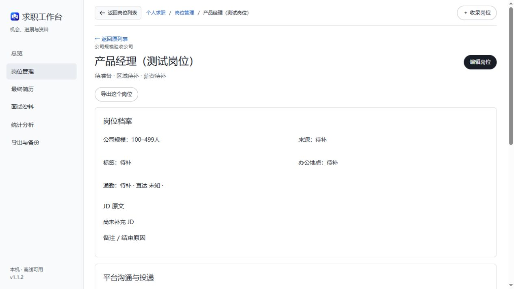

# 个人求职工作台

一个以岗位为中心的中文求职管理工具：集中保存岗位、平台进展、最终简历、面试资料和复盘，并支持原件导出与完整备份恢复。

**当前应用版本：v1.1.2 · 数据结构：schema 5 · Windows 本机单人使用。**

界面在浏览器中打开，程序和数据运行在自己的电脑上。基础使用无需联网，不包含内置 AI、自动投递或爬虫。



*截图来自虚构测试岗位，不包含真实求职资料。*

## 可以做什么

- **岗位管理**：仅填公司和岗位名称即可收录，后续补 JD、公司规模、薪资范围、区域、通勤、标签、星标和备注。地区选项目前按宁波区县市设置，另有“其他”。
- **集中补记**：同一岗位可记录多个招聘平台；沟通、简历发送、阅读、回复、邀约分别记录。整体阶段由本人手动选择。
- **最终简历**：管理最终 PDF，可跨岗位准备关联，并追溯每个平台实际发送的文件；准备关联不代表已发送。
- **面试资料**：背调、模拟面试、真实面试复盘和外部分析结果，可跨岗位共享。复盘为自由文本，不要求固定提纲。
- **图片和附件**：岗位备注及资料支持 PDF、PNG、JPG/JPEG、WebP，多文件选择及专用区域 Ctrl+V 粘贴截图；详情可放大图片、预览 PDF。资料另保留 Markdown／PDF／Word 文档入口。
- **查找与统计**：折叠搜索、标签和状态筛选、分页与返回位置保持；统计区分岗位和平台记录，说明分母与未知日期。
- **导出与恢复**：单岗位、当前筛选或全部分析 ZIP；数据库一致快照和全部引用原件组成的完整备份，可在独立目录恢复。

## 下载与准备

当前提供的是**源码版**，不是已经包含 Python 的免安装软件包。下载仓库 ZIP 后请先完整解压；也可使用 Git：

```powershell
git clone https://github.com/SyverQiu1333f/personal-job-workbench.git
cd personal-job-workbench
```

运行环境为 Windows、Python 3.12 和现代桌面浏览器。已验证的本机环境为 Python 3.12.10、SQLite 3.49.1；其他平台尚未验证，启动器依赖 Windows 文件锁，不适合直接在 Linux／macOS 上运行。

## 首次启动

先安装 Python 3.12。在解压后的项目目录打开 PowerShell，执行：

```powershell
py -3.12 -m venv .venv
.\.venv\Scripts\python.exe -m pip install -r requirements-lock.txt
.\启动工作台.bat
```

安装依赖时需要联网。若没有 `py` 命令，可确认 `python --version` 为 3.12 后执行 `python -m venv .venv`，再继续后两步。无需激活虚拟环境，也无需更改 PowerShell 执行策略。

安装完成后，日常双击 **启动工作台.bat** 即可自动打开浏览器。可右键该文件，在“显示更多选项 → 发送到 → 桌面快捷方式”创建桌面入口；菜单文字可能因 Windows 版本而异。

- 默认访问 `http://127.0.0.1:8765`。端口被其他程序占用时自动寻找空闲端口，实际端口保存在 `run/port.txt`，以启动器打开的地址为准。
- 重复启动会复用已确认身份的当前工作区服务，不应开启第二份实例。
- 保持启动窗口运行；结束使用时在窗口按 Ctrl+C。**关闭浏览器不会停止后台服务。**
- 首次启动自动创建自己的空白数据目录，不包含作者的岗位、简历或附件。

## 数据和附件在哪里

```text
data/
  config.local.toml       本机工作区身份、地址和默认端口
  session.key             本机表单会话配置
  data-epoch.txt          恢复后的旧表单保护
  current/
    db.sqlite3           岗位、进展、资料及关联，SQLite DELETE
    files/               按 SHA256 保存的上传原件副本
  backups/               完整备份目录和清单
  staging/               上传临时文件、恢复预览
  previous-*/            恢复前额外保留的旧活动目录
run/                     服务锁、身份与实际端口
logs/                    运行日志及启动错误
```

上传并保存成功后，原件已复制到工作台；删除或移动最初上传的源文件不会影响工作台副本。每个业务附件最多 **50,000,000 字节**，整包备份恢复不套用这个限制。超大像素图片还会接受可解码性与尺寸检查。

以上运行数据已在 `.gitignore` 排除。分享程序或提交 Git 时保留这些排除规则；程序更新与个人数据分别管理。

## 备份、恢复与导出

在“导出与备份”创建并下载**完整备份 ZIP**。系统也会在每个北京时间修改日的首次写入前留完整快照，保留最近 7 个修改日；手动、恢复前和迁移前快照不自动轮换。建议另外保存一份完整 ZIP 到其他磁盘。

恢复时选择完整备份 ZIP，先“校验并预览”，确认覆盖范围后再恢复。恢复会覆盖目标工作区当前资料，系统会先留恢复前快照；需要检查旧资料时，优先使用独立目录：

```powershell
.\.venv\Scripts\python.exe launcher.py --data-dir "D:\求职恢复检查\data"
```

分析 ZIP 用于阅读和复盘，包含 Markdown 汇总、CSV、JSON 关联及原件；**不能代替完整备份用于恢复**。清单说明正文／原件提供情况，不做 OCR，不自动提取 PDF／Word 正文，不判断其他 AI 工具能否读取附件。

## 更新与让 AI 协助更新

1. 在工作台完成完整备份并保留 ZIP。
2. 退出工作台服务，保留整个 `data/`，再更新代码和依赖。
3. Git 安装且工作区干净时可执行 `git pull --ff-only`；有本地修改时先查看差异，不强制覆盖。
4. 执行 `.\.venv\Scripts\python.exe -m pip install -r requirements-lock.txt`，再启动并核对版本、岗位、附件和备份。

ZIP 安装用户应保留旧目录和完整备份，使用经过审查的新版程序文件更新，不能直接用一个空白数据目录覆盖旧资料。详细步骤和可交给 AI 的指引见 [AI 更新指引](docs/AI_UPDATE.md)。GitHub 不会自动更新本机，当前没有内置自动更新器。

当前代码支持 schema 1／2／3／4 经完整迁移前备份后升级至 schema 5；失败回滚并停止启动。**v1.1.1 及更早代码不能直接运行 schema 5。** Git 回退不等于恢复数据，不通过删除数据库解决不兼容。

## 技术与开发验证

Python · Flask · Jinja · HTMX · Waitress · SQLite · 本地附件目录。前端脚本、PDF.js、字体和样式随仓库保存，运行时没有 CDN 依赖。

```powershell
.\.venv\Scripts\python.exe -m pytest -q
```

测试使用临时／隔离目录。v1.1.2 本机回归记录为 60 项通过，覆盖上传、共享原件、旧表单、导出、恢复、迁移与 Windows 启动等；这是已验证环境的结果，不代表所有电脑均已验证。

主要代码位于 `workbench/`，启动器为 `launcher.py`，测试位于 `tests/`，依赖完整版本见 `requirements-lock.txt`。

## 当前范围与许可

- 只支持本机单人使用，没有公网账号体系或多人隔离；不能直接当作公网服务部署，GitHub Pages 也无法运行本项目后端。
- Word 以原件保存和下载；PDF 使用本地 PDF.js 预览，加密／损坏文件可能无法预览但仍可取回原件。
- 未提供手机入口、自动投递、爬虫、内置 AI 或免安装发行包。
- 当前尚未为项目自身添加开源许可证；公开源码不代表已采用 MIT 等许可证。第三方组件保持各自许可，见 [第三方组件说明](docs/THIRD_PARTY_NOTICES.md)。

公开仓库从经检查的源码快照开始，不包含作者的业务数据、本机配置、私人评审文档或本地开发历史。
